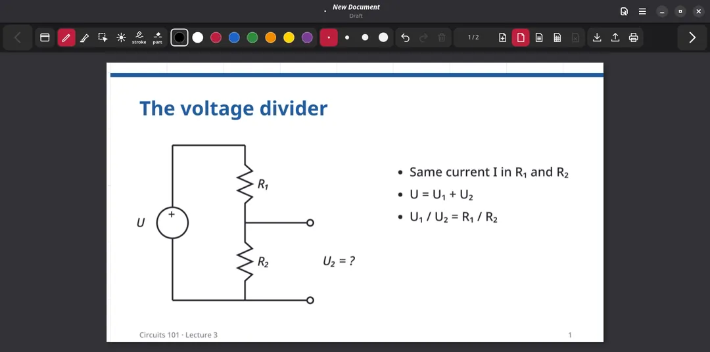

<div align="center">


# Tafel

**Annotate PDF lecture slides with a pen, one slide at a time.**

*Tafel* is German for blackboard.



</div>

---

> [!IMPORTANT]
> **Tafel is a modified fork of [Rnote](https://github.com/flxzt/rnote)** by Felix Zwettler and
> the Rnote contributors. Rnote does the hard work: the drawing engine, stroke rendering,
> PDF import and export, the file format and most of the GTK app.
> Tafel replaces the user interface with a slide-focused toolbar and fixes some crashes.
> Tafel is not affiliated with or endorsed by the Rnote project. Please report Tafel bugs
> [here](https://github.com/ansgomez/tafel/issues), not upstream.

## Status

- **Linux only.** Tafel is built and tested on Fedora 44 with GNOME.
- **Source only.** There are no Tafel packages, Flatpaks or installers. Build it from source as
  described below. Rnote packages (Flathub, distributions) install Rnote, not Tafel.
- **Maintenance mode.** Tafel gets bug fixes only. New features are not planned in this
  repository.

## Why

[MarpX](https://github.com/cunhapaulo/MarpX) slide decks can carry an annotation mode: a slim
dark toolbar, one slide at a time, a pen, a highlighter, a laser pointer, and blank pages for
working through an example during a lecture. Tafel brings that experience to **any PDF**,
as a native app for Linux pen tablets such as the Framework 12.

## Features

- **One page at a time.** The page fits the whole window. Turn pages with the toolbar,
  Alt+Page Up/Down, or a quick two-finger swipe.
- **A compact toolbar** in the style of the MarpX annotation mode. Dark, dockable on any window
  edge, with only the tools needed for teaching:
  - pen and highlighter, with 8 colors and 4 sizes each
  - selector: tap, rectangle, or lasso, depending on how you draw
  - laser pointer with a fading trail
  - stroke eraser and partial eraser, with a cursor that shows the erased area
  - undo, redo, clear page
- **Blank pages.** Insert a plain, lined, or grid page after the current slide (Ctrl+Shift+B),
  for example for a worked example. Blank pages can be deleted again. The counter shows
  them as "3 / 37 · blank 1/2".
- **Your PDF stays untouched.** Notes are saved as `.rnote` files and exported as an
  annotated PDF.
- **Backup files.** Unsaved changes are written to a backup file next to the document,
  see [Backups](#backups).
- **Rnote compatible.** Tafel reads and writes the Rnote file format, so the notes also open in
  Rnote.

## What changed compared to Rnote

| | Rnote | Tafel |
|---|---|---|
| Toolbar | Sidebars, pen picker, color picker | One compact slide toolbar |
| Tools | Brush styles, shapes, typewriter, tools | Pen, highlighter, selector, laser, two erasers |
| Page view | Continuous or infinite canvas | Single page, fitted to the window |
| Navigation | Scrolling | Page turns, keyboard, two-finger swipe |
| Blank pages | Append at the end | Insert after any page, with paper |
| PDF import | Spacing and width options | One page per PDF page, full width |
| Platforms | Linux, Windows, macOS | Linux |
| App ID | `com.github.flxzt.rnote` | `io.github.ansgomez.tafel` |

Tafel also fixes two crashes in the Rnote engine: a panic when drawing after undo, redo or
loading a file, and a panic on pen input that cannot be transformed (for example NaN
pressure from some tablet drivers).

## Install from source (Fedora)

These steps install Tafel for your user only, into `~/.local`. Only the package installation
needs `sudo`.

### 1. Install the build dependencies

```bash
sudo dnf install \
    gcc gcc-c++ clang clang-devel python3 make cmake meson git appstream gettext \
    desktop-file-utils shared-mime-info gtk4-devel libadwaita-devel alsa-lib-devel \
    appstream-devel rust cargo
```

Tafel needs Rust 1.89 or newer (Fedora 44 ships 1.99), GTK 4.22 or newer and libadwaita 1.9
or newer. If you already use [rustup](https://rustup.rs), leave out `rust cargo`.

### 2. Get the source and build

```bash
git clone https://github.com/ansgomez/tafel
cd tafel
meson setup --prefix="$HOME/.local" -Dcli=false _mesonbuild
meson compile -C _mesonbuild
```

The release build uses full link-time optimization and takes several minutes. For faster
rebuilds, see "Faster local builds" in [BUILDING.md](BUILDING.md).

### 3. Install

```bash
meson install -C _mesonbuild
```

This installs the `tafel` binary to `~/.local/bin` and the desktop entry, icons, settings
schema and MIME type to `~/.local/share`. No root access is needed.

### Run

Start **Tafel** from the app menu (category Education), or from a terminal:

```bash
~/.local/bin/tafel lecture.pdf
```

Confirm the PDF import dialog with **Import**. Save your notes with Ctrl+S (as an `.rnote`
file) and export the annotated PDF with the **Export PDF** button in the toolbar.

### Update

```bash
cd tafel
git pull
meson compile -C _mesonbuild
meson install -C _mesonbuild
```

### Uninstall

Your settings are kept after uninstalling. To remove them too, reset them first:

```bash
gsettings reset-recursively io.github.ansgomez.tafel
```

Then remove the installed files:

```bash
cd tafel
ninja -C _mesonbuild uninstall
```

### Try it without installing

The app needs its settings schema. You can compile the schema into the build directory and run
the binary from there:

```bash
mkdir -p _mesonbuild/schemas
cp _mesonbuild/crates/rnote-ui/data/io.github.ansgomez.tafel.gschema.xml _mesonbuild/schemas/
glib-compile-schemas _mesonbuild/schemas
GSETTINGS_SCHEMA_DIR=_mesonbuild/schemas _mesonbuild/target/release/tafel
```

## Using Tafel next to Rnote

Tafel and Rnote can be installed at the same time, including an Rnote Flatpak:

- Tafel has its own app ID (`io.github.ansgomez.tafel`), binary (`tafel`), settings and data
  directory, so it does not change Rnote's settings.
- Both apps register for `.rnote` files. Pick the default app with **Open With** in your file
  manager.
- Build Tafel with `-Dcli=false`, as above. Without it, Tafel also installs `rnote-cli` and the
  `.rnote` thumbnailer, which replace the copies of a native Rnote install in the same prefix.

## Usage

| Action | Input |
|---|---|
| Next / previous page | Toolbar arrows, Alt+Page Down / Alt+Page Up, two-finger swipe left / right |
| Insert a blank page after the current one | Toolbar, Ctrl+Shift+B |
| Undo / redo | Toolbar, Ctrl+Z / Ctrl+Shift+Z |
| Save / open | Toolbar, Ctrl+S / Ctrl+O |
| Move the toolbar to another edge | First toolbar button |
| Zoom | Pinch; the next page turn fits the page again |

## Backups

While a document has unsaved changes, Tafel writes a backup every two minutes to
`<name>.backup.rnote` in the same folder as the edited file. For a PDF that was never saved
as `.rnote`, the backup goes next to the PDF (`slides.pdf` gives `slides.backup.rnote`).
A new document that has no file yet gets no backup.

- Saving the document, or closing it, deletes the backup.
- When you open a file and a backup with different content exists (for example after a
  crash), Tafel asks whether to restore it. **Restore** loads the backup as unsaved changes,
  so save to keep them. **Discard** deletes the backup. If the backup matches the file, it is
  deleted silently. Closing the dialog without a choice keeps the backup until the document
  is saved or closed.
- You can also open a `.backup.rnote` file directly, like any other document.
- Turn backups off in Preferences, *Backup Files*
  (`gsettings set io.github.ansgomez.tafel backups false`).

Backups complement Rnote's autosave, which only rewrites documents that already have a
`.rnote` file.

## Reporting issues

Open an issue at <https://github.com/ansgomez/tafel/issues>. Please include:

- your distribution and desktop (for example Fedora 44, GNOME, Wayland)
- the Tafel commit you built (`git rev-parse --short HEAD`)
- your input device (pen tablet, touch screen, mouse)
- the steps to reproduce, and if possible the terminal output of

  ```bash
  RUST_LOG=tafel=debug,rnote_engine=debug RUST_BACKTRACE=1 ~/.local/bin/tafel
  ```

If the bug also happens in Rnote itself, please report it to
[Rnote](https://github.com/flxzt/rnote/issues) as well.

## Development

[BUILDING.md](BUILDING.md) covers build options, tests, debugging and merging upstream
changes. The crates in `crates/` keep their upstream names (`rnote-engine`, `rnote-compose`,
...), so upstream changes can still be merged. [docs/arch.md](docs/arch.md) describes the
architecture inherited from Rnote.

## License and credits

Tafel is licensed under the **GNU General Public License v3.0 or later**, the same license
as Rnote. See [LICENSE](LICENSE).

- **[Rnote](https://github.com/flxzt/rnote)**: © Felix Zwettler and the Rnote contributors
  (see [AUTHORS](AUTHORS)), GPL-3.0-or-later. If you find Tafel useful, consider
  [supporting Rnote](https://rnote.flxzt.net/#support).
- **Tafel changes**: © 2026 Andres Gomez, GPL-3.0-or-later. The commit history shows every
  change on top of Rnote.
- **[MarpX](https://github.com/cunhapaulo/MarpX)** by Paulo Cunha (MIT) inspired the look.
  The toolbar design follows the MarpX annotation mode written by Andres Gomez.
- The slides in the demo are generated by
  [misc/demo/make_sample_pdf.py](misc/demo/make_sample_pdf.py).
